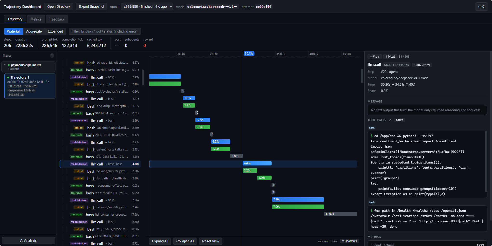
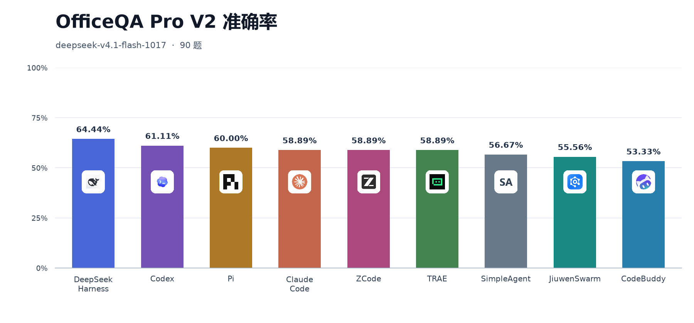
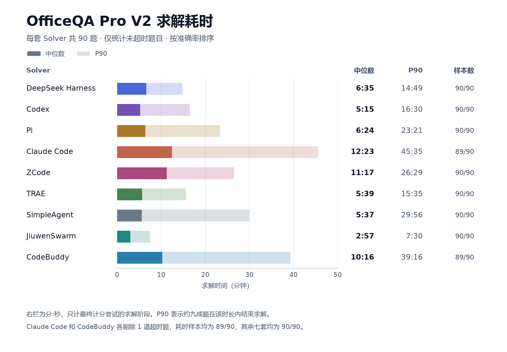
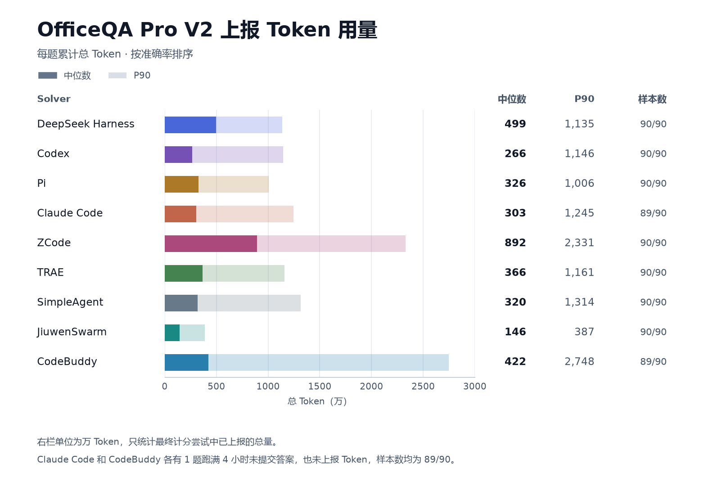

<h1 align="center">
  
</h1>

<h3 align="center">Many ways to evaluate. One framework to bring them together.</h3>

<p align="center">
  A plugin-based framework for evaluating agent harnesses, inference engines, and kernels, with more areas to come.
</p>

<p align="center">
  
  
  
</p>

<p align="center">
  English | <a href="./README.zh-CN.md">中文</a>
</p>

<p align="center">
  <a href="docs/users/quick-start.md">Quick Start</a> ·
  <a href="#officeqa-pro-v2">OfficeQA results</a> ·
  <a href="docs/users/README.md">Documentation</a> ·
  <a href="playbook/README.md">Playbooks</a> ·
  <a href="docs/development/plugins.en.md">Plugins</a>
</p>

## ℹ️ Introduction

**ARSI-Evaluator** is a unified, plugin-based framework for **agent harness capability evaluation, inference engine performance evaluation, and kernel performance evaluation**. It can be extended to support more evaluation scenarios.

The framework uses YAML configuration and composable components to define evaluation workflows. It supports local, containerized, and distributed execution, records results, helps diagnose failures, and lets you resume interrupted runs.


*ARSI-Evaluator architecture overview. For design details, see [Source architecture and execution flow](docs/development/architecture.en.md).*

## ⚙️ Features

- **Evaluation scenarios**: Evaluate agent harnesses, inference engines, and kernels using supported benchmarks or custom tasks. [Benchmark list](docs/users/README.md#supported-benchmarks)
- **Agent integrations**: Use the built-in SimpleAgent or connect agent harnesses such as DSH, Dify, Pi, and DeepAgents through AgentBundle. [Agent integrations](docs/users/solvers.md)
- **Execution modes**: Run locally, in Docker, or across Ray nodes, with configurable concurrency, environment warmup, and network settings. [Execution modes](docs/users/usage.md#local-docker-and-ray)
- **Reliable evaluation runs**: Save execution evidence, diagnose failures, resume interrupted runs, and retry tasks that failed due to network errors. [Resume and recovery](docs/users/usage.md#resume-and-rebuild-reports) · [Network retries](docs/users/network-retry.md)
- **Metrics and trajectory analysis**: Calculate evaluation metrics, generate reports offline, and inspect execution trajectories and feedback with Tracer. [Results and reports](docs/users/usage.md#read-results)
- **Plugins and SDK**: Add custom evaluation components or integrate evaluations using the Node.js SDK. [Plugin development](docs/development/README.en.md#add-your-first-component) · [SDK integration](docs/users/sdk.md)

## 🧪 Supported Benchmarks

ARSI-Evaluator covers three types of evaluation. See the [benchmark list](docs/users/README.md#supported-benchmarks) for the full list and run requirements.

| Evaluation area | Representative benchmarks | What it evaluates |
| --- | --- | --- |
| Model and agent capabilities | GSM8K, MMLU, SWE-bench, Terminal-Bench, WorkBuddy, OfficeQA, and others | Evaluate question answering, coding, terminal, office, and web tasks. Custom Harbor tasks are also supported. |
| Inference engine performance | AgentX, AISBench | Replay agent request traces and load-test model services to measure throughput, latency, and prefix cache metrics. [AgentX guide](docs/users/benchmarks/agentx.md) · [AISBench guide (Chinese)](plugins/aisbench/README.md) |
| Kernel performance | kernel | Verify kernel correctness and measure execution time and speedup. [Kernel evaluation guide](docs/users/benchmarks/kernel-npu.md) |

## 📦 Installation

### Install with a Coding Agent

Give your coding agent the following instructions to install and verify the CLI and Skill.

```text
Install the ARSI-Evaluator CLI and the accompanying arsi-evaluator Skill from https://github.com/ARSI-LAB/ARSI-Evaluator.
Follow the manual installation steps in the README to install the CLI, then install the Skill for yourself in the current project.
Run arsi-evaluator --help to verify the CLI and confirm that you can discover and read the Skill. Stop after verifying both.
```

### Manual Installation

#### 1. Install the CLI

You need Node.js 24.x (at least 24.22.1), pnpm 11 or 12, and Git. If pnpm is missing, run `npm install -g pnpm`.

```bash
git clone https://github.com/ARSI-LAB/ARSI-Evaluator.git arsi-evaluator
cd arsi-evaluator
pnpm install --frozen-lockfile
pnpm build
pnpm add -g .
arsi-evaluator --help
```

The help output confirms the CLI is installed.

#### 2. Install the Agent Skill (Optional)

Run the following command in your target project to install the Skill for your coding agent.

```bash
npx skills add ARSI-LAB/ARSI-Evaluator --skill arsi-evaluator
```

For other installation methods and troubleshooting, see the [installation guide](docs/users/installation.md).

## 🚀 Quick Start

Run two GSM8K questions with the built-in SimpleAgent. Use Bash from the repository root and configure a model service that supports OpenAI Chat Completions and tool calling.

```bash
export MODEL_NAME="your-model-id"
export MODEL_ENDPOINT="https://your-model-service.example/v1"
export MODEL_API_KEY="your-api-key"

arsi-evaluator inspect playbook/gsm8k/gsm8k-quick-start.yaml
arsi-evaluator run playbook/gsm8k/gsm8k-quick-start.yaml
```

Use `inspect` to check the experiment configuration and `run` to start the evaluation. When it finishes, open `report.md` in the results directory. See the [quick-start guide](docs/users/quick-start.md) for the full walkthrough and command-line examples.

For other evaluation scenarios, see the [Terminal-Bench 4.0 quick start](docs/users/quick-start/terminalbench.md) and the [AgentX performance quick start](docs/users/quick-start/agentx.md). Find more experiment configurations in the [Playbook examples](playbook/README.md).

## 🔥 Warmup Before Evaluation (Optional)

For evaluations that need Docker images, you can check the environment and prepare images and runtime dependencies ahead of time to reduce setup time during the evaluation.

```bash
arsi-evaluator doctor playbook/terminalbench/terminalbench-4.0.yaml
arsi-evaluator warmup playbook/terminalbench/terminalbench-4.0.yaml
arsi-evaluator run playbook/terminalbench/terminalbench-4.0.yaml
```

Use `doctor` to check the environment, `warmup` to prepare images and dependencies, and `run` to start the evaluation. Warmup makes no model calls and performs no scoring. The evaluation can reuse the prepared images. See the [warmup guide](docs/users/usage.md#warm-images-without-evaluation) for details.

The project publishes benchmark evaluation images in its [ModelScope image repository](https://www.modelscope.cn/datasets/evolving-foundry/ember-evaluator). Use `--network` to configure the image source. See the [image download guide](docs/users/image-downloads.md#download-task-images-from-modelscope) for instructions.

## 🛰️ Tracer for Trajectory and Feedback Analysis

Tracer lets you inspect agent trajectories, performance metrics, and optimization feedback. It shows model calls, tool events, and their timing, and provides rule-based diagnostics and optional LLM analysis. Add `--tracer` to enable it for an evaluation.

```bash
arsi-evaluator run playbook/gsm8k/gsm8k-quick-start.yaml --tracer
```

Tracer starts the local Collector on demand. On the machine running the Collector, open `http://127.0.0.1:8787` in your browser to view trajectories and feedback.



*Tracer trajectory analysis view. See the [Tracer guide](docs/users/tracer.md) for configuration and troubleshooting.*

## 📊 Evaluation Results

### Same benchmark, different models

#### OfficeQA Pro V2

Both models ran the same 90 OfficeQA Pro V2 questions with each of the nine solvers. GLM ran with low reasoning effort.

| Solver | [`deepseek-v4.1-flash-1017`](docs/experiment/officeqa-pro-v2/deepseek-v4.1-flash-1017/report.md) | [`glm-5.3-flash`](docs/experiment/officeqa-pro-v2/glm-5.3-flash/report.md) |
| --- | ---: | ---: |
| DeepSeek Harness | 64.44% (58/90) | 42.22% (38/90) |
| Codex | 61.11% (55/90) | 43.33% (39/90) |
| Pi | 60.00% (54/90) | 38.89% (35/90) |
| Claude Code | 58.89% (53/90) | 26.67% (24/90) |
| ZCode | 58.89% (53/90) | 47.78% (43/90) |
| TRAE | 58.89% (53/90) | 38.89% (35/90) |
| SimpleAgent | 56.67% (51/90) | 40.00% (36/90) |
| JiuwenSwarm | 55.56% (50/90) | 45.56% (41/90) |
| CodeBuddy | 53.33% (48/90) | 27.78% (25/90) |

### Same model, different solvers

These charts compare nine solvers using `deepseek-v4.1-flash-1017` on OfficeQA Pro V2.



**Accuracy.** DeepSeek Harness led with 58 correct answers out of 90 (64.44%).



**Solve time.** JiuwenSwarm had the lowest median solve time at 2 min 57 s.



**Reported token usage.** JiuwenSwarm had the lowest median at 1.46 million tokens per question.

[All experiment results](docs/experiment/README.md)

## 📖 Guides

- **Configure experiments**: [Configuration guide](docs/users/config.md) · [Solvers and model services](docs/users/solvers.md)
- **Choose an evaluation scenario**: [Benchmark guides](docs/users/benchmarks/README.md) · [AgentX performance evaluation](docs/users/benchmarks/agentx.md) · [Playbook examples](playbook/README.md)
- **Run and manage evaluations**: [Daily operations](docs/users/usage.md) · [Concurrency and environment preparation](docs/users/concurrency.md) · [Image cleanup](docs/users/usage.md#delete-evaluation-images)
- **Extend and integrate**: [Plugin development and loading](docs/development/plugins.en.md) · [SDK integration](docs/users/sdk.md)
- **Troubleshoot and recover**: [FAQ](docs/users/faq/README.md) · [Error code reference](docs/users/reference/errors.md) · [Retrying network failures](docs/users/network-retry.md)

## 🔗 Related Projects

- [RSI](https://github.com/ARSI-LAB/ARSI) is a plugin-based recursive self-improvement (RSI) framework for agents and AI infrastructure. It uses feedback from ARSI-Evaluator to generate and refine candidate solutions across iterations.
- [AgentBundle](https://github.com/ARSI-LAB/agentbundle) packages and manages configurations, skills, and plugins across agent harnesses, making it easier to integrate and evaluate different agents in ARSI-Evaluator.

## 🙏 Acknowledgments

Thanks to the maintainers and contributors of [Cordis](https://github.com/cordiverse/cordis) and [Harbor](https://github.com/harbor-framework/harbor). ARSI-Evaluator uses Cordis to manage plugins and their lifecycles and supports running and verifying evaluation tasks using the Harbor protocol.
