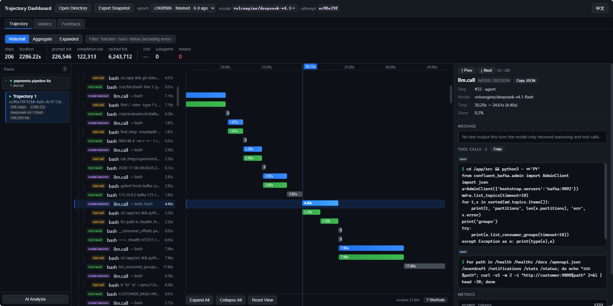

<h1 align="center">
  
</h1>

<p align="center">
  A plugin-based framework for evaluating Agent Harness capabilities, inference engine performance, and kernel performance from YAML.
</p>

<p align="center">
  
  
  
</p>

<p align="center">
  English | <a href="./README.zh-CN.md">中文</a>
</p>

<p align="center">
  <a href="#quick-start">Quick Start</a> ·
  <a href="#tracer">Tracer</a> ·
  <a href="docs/users/README.md">Documentation</a> ·
  <a href="playbook/README.md">Playbooks</a>
</p>


## What You Can Evaluate

| Scenario | What it measures | Start here |
| --- | --- | --- |
| Agent Harness | Scores and pass rates on terminal, coding, and office tasks | [Terminal-Bench quick start](docs/users/quick-start/terminalbench.md) |
| Inference Engine | Time to first token (TTFT) and throughput. Optional metrics include vLLM KV cache usage and Ascend NPU AI Core utilization. | [Inference performance quick start](docs/users/quick-start/agentx.md) |
| Kernel | Correctness, execution time, and speedup on Ascend NPU | [Kernel evaluation guide](docs/users/benchmarks/kernel-npu.md) |

[Full benchmark list](docs/users/README.md#supported-benchmarks)

## Quick Start

[Install the CLI](docs/users/installation.md#install-from-source) to run two GSM8K questions locally with SimpleAgent. Replace the example model ID and URL with those of an OpenAI Chat Completions service that supports tool calling. Run the commands in Bash from the repository root.

```bash
export MODEL_NAME="your-model-id"
export MODEL_ENDPOINT="https://your-model-service.example/v1"
read -rsp 'Model API key: ' MODEL_API_KEY
printf '\n'
export MODEL_API_KEY

ember-evaluator inspect playbook/gsm8k/gsm8k-quick-start.yaml
ember-evaluator run playbook/gsm8k/gsm8k-quick-start.yaml
```

`inspect` shows the resolved configuration. After `run` finishes, open `report.md` in the results directory printed by the CLI. [Full walkthrough and PowerShell commands](docs/users/quick-start.md)

## Tracer

Use the same configuration to inspect Agent trajectories, performance metrics, and optimization feedback. Tracer starts the local Collector on demand.

```bash
ember-evaluator run playbook/gsm8k/gsm8k-quick-start.yaml --tracer
```

On the machine running the Collector, enter `http://127.0.0.1:8787` in your browser's address bar.



[Tracer setup and troubleshooting](docs/users/tracer.md)

## Extend with Plugins

Select components in YAML and load custom components with `--patch`. [Add a Solver](docs/development/add-solver.en.md) · [Add a built-in component role](docs/development/add-built-in-plugin.en.md) · [Add an external plugin](docs/development/add-external-plugin.en.md) · [Source architecture](docs/development/architecture.en.md)

## Evaluation Results

These runs used **DeepSeek V4.1 Flash 1017**. Scores follow each benchmark’s rules.

| Benchmark | Agent Harness | Result |
| --- | --- | --- |
| GSM8K | SimpleAgent | 92.34% (1,218 / 1,319) |
| MMLU | choice-logprobs | 88.83% (12,474 / 14,042) |
| WorkBuddy | SimpleAgent | Office 0.8502 · Code 0.9009 · Web 0.7957 |
| OfficeQA Pro V2 | SimpleAgent | 56.67% (51 / 90) |

## Documentation

- [User guide](docs/users/README.md) · [Playbooks](playbook/README.md) · [Node.js SDK](docs/users/sdk.md)
- [CLI commands](docs/users/reference/cli.md) · [Experiment YAML fields](docs/users/reference/experiment-yaml.md) · [Solvers and model services](docs/users/solvers.md)
- [Installation and agent skill](docs/users/installation.md) · [Local, Docker, and Ray](docs/users/usage.md#local-docker-and-ray) · [Image warmup](docs/users/usage.md#warm-images-without-evaluation) · [ModelScope downloads](docs/users/image-downloads.md#download-task-images-from-modelscope)
- [Resume and rebuild reports](docs/users/usage.md#resume-and-rebuild-reports) · [Network retries](docs/users/network-retry.md) · [FAQ](docs/users/faq/README.md)

## 🙏 Acknowledgments

Thanks to the Cordis maintainers and contributors. Ember Evaluator uses Cordis to register plugins and manage component lifecycles. [Cordis project](https://github.com/cordiverse/cordis)

Thanks to the Harbor maintainers and contributors. Ember Evaluator supports Harbor task packages and follows Harbor protocols for task execution and verification. [Harbor project](https://github.com/harbor-framework/harbor)

## 🔗 Related Projects

- [Ember RSI](https://github.com/evolving-foundry/ember-rsi): Tools for iterative optimization through measured experiments.
- [AgentBundle](https://github.com/evolving-foundry/agentbundle): A unified CLI and SDK for validating, installing, and managing agent bundles across runtimes.
