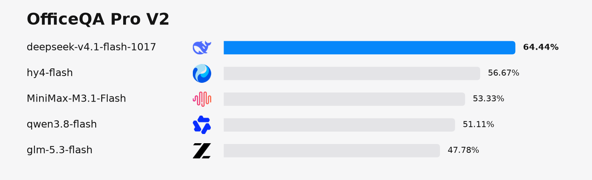
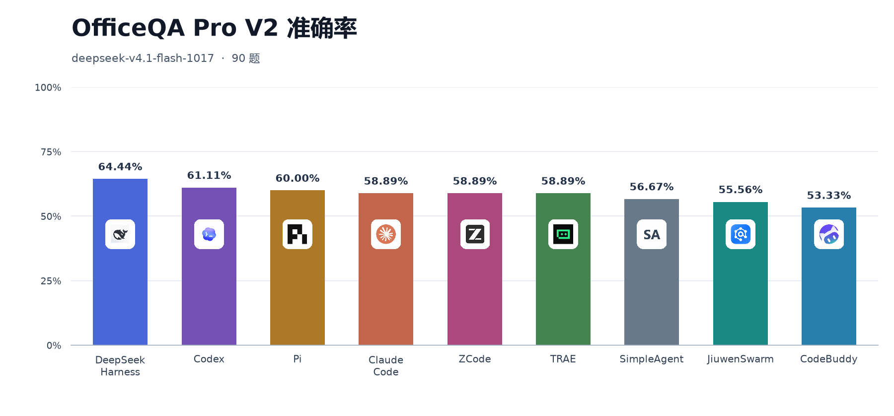
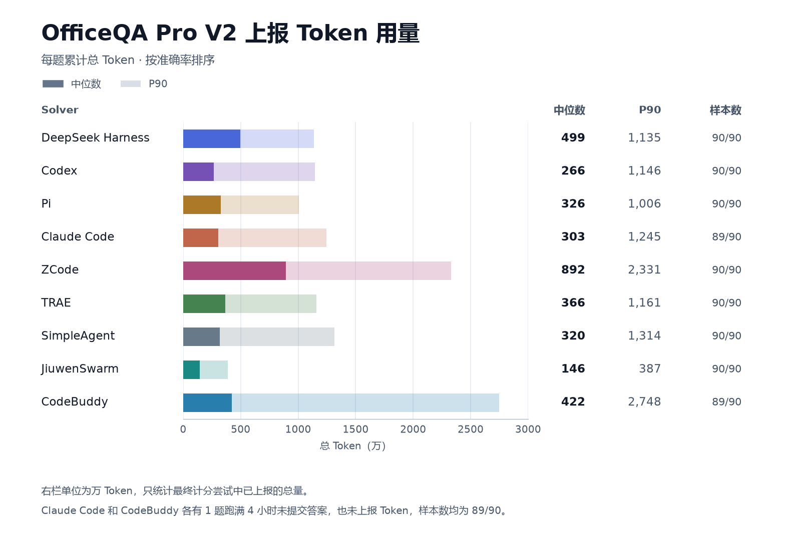
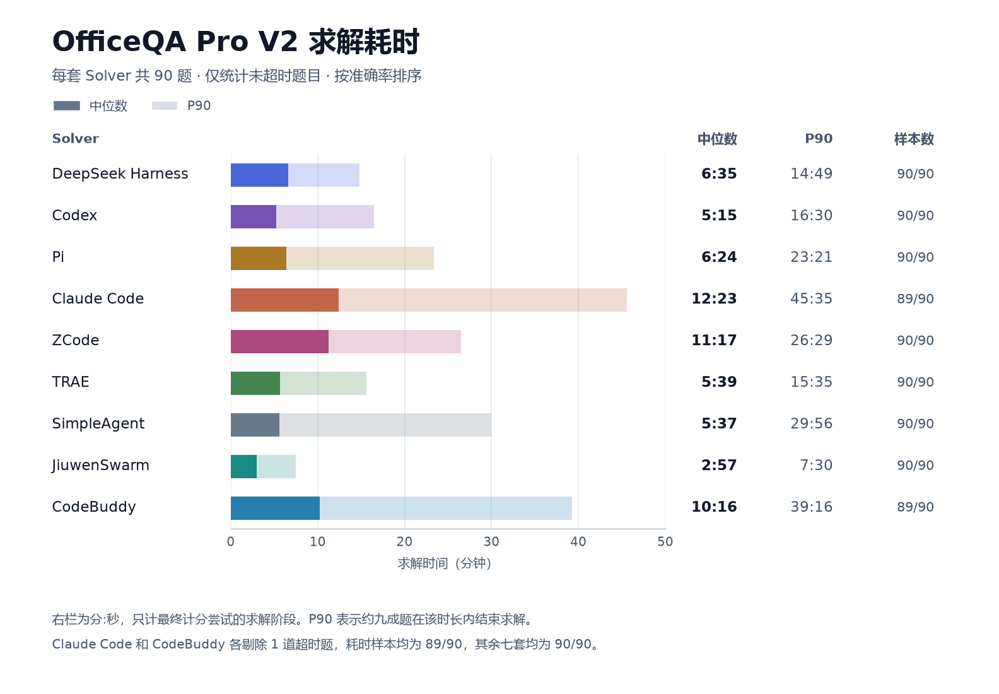
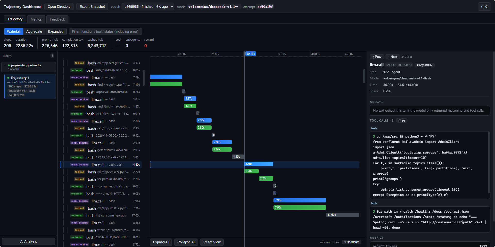

<h1 align="center">
  
</h1>

<h3 align="center">多种评测方法，一个框架统一承载。</h3>

<p align="center">
  插件化评测框架，覆盖 Agent Harness、推理引擎和算子，并将扩展到更多评测领域。
</p>

<p align="center">
  
  
  
</p>

<p align="center">
  <a href="./README.md">English</a> | 中文
</p>

<p align="center">
  <a href="docs/users/quick-start.zh-CN.md">快速开始</a> ·
  <a href="docs/users/README.zh-CN.md">使用文档</a> ·
  <a href="playbook/README.md">实验配置</a> ·
  <a href="docs/development/plugins.md">插件开发</a>
</p>

## ℹ️ 简介

**ARSI-Evaluator** 是一个插件化的统一评测框架，支持 **Agent Harness 能力评测、推理引擎性能评测和算子性能评测**，并可扩展至更多评测场景。

框架通过 YAML 配置和可组合的评测组件组织评测流程，支持本地、容器及分布式执行，提供结果记录、故障诊断与断点续跑等能力。


*ARSI-Evaluator 整体架构概览，详细设计参见 [源码架构与执行流程](docs/development/architecture.md)。*

## ⚙️ 功能介绍

- **多场景评测**：支持 Agent Harness、推理引擎和算子评测，兼容多种 Benchmark 与自定义任务。 [Benchmark 列表](docs/users/README.zh-CN.md#现在能测哪些-benchmark)
- **多种 Agent 接入**：支持内置 SimpleAgent，并可通过 AgentBundle 接入 DSH、Dify、Pi、DeepAgents 等 Agent Harness。 [Agent 接入](docs/users/solvers.zh-CN.md)
- **灵活的执行方式**：支持本地、Docker 和 Ray 分布式执行，提供并发控制、环境预热及网络配置。 [执行模式](docs/users/usage.zh-CN.md#本地docker-与-ray)
- **可靠的评测流程**：支持执行证据留存、故障诊断、中断续跑及网络失败补测。 [续跑与恢复](docs/users/usage.zh-CN.md#续跑与重建报告) · [网络补测](docs/users/network-retry.zh-CN.md)
- **指标与轨迹分析**：支持评测指标统计、离线报告生成，以及通过 Tracer 查看执行轨迹与反馈。 [结果与报告](docs/users/usage.zh-CN.md#如何读结果)
- **插件与 SDK 扩展**：支持自定义评测组件，并提供 Node.js SDK 集成评测能力。 [插件开发](docs/development/README.md#第一次新增组件) · [SDK 集成](docs/users/sdk.zh-CN.md)

## 🧪 支持的 Benchmark

ARSI-Evaluator 覆盖以下三类评测场景，完整支持列表及运行条件参见 [Benchmark 列表](docs/users/README.zh-CN.md#现在能测哪些-benchmark)。

| 评测方向 | 代表性 Benchmark | 评测内容 |
| --- | --- | --- |
| 模型与 Agent 能力评测 | GSM8K、MMLU、SWE-bench、Terminal-Bench、WorkBuddy、OfficeQA 等 | 覆盖问答、编程、终端、办公及网页等任务，支持自定义 Harbor 任务。 |
| 推理引擎性能评测 | AgentX、AISBench | 支持 Agent 请求轨迹回放与模型服务压测，测量吞吐量、延迟及 Prefix Cache 等性能指标。 [AgentX 指南](docs/users/benchmarks/agentx.zh-CN.md) · [AISBench 指南](plugins/aisbench/README.md) |
| 算子性能评测 | kernel | 验证算子正确性，测量执行耗时与加速比。 [算子评测指南](docs/users/benchmarks/kernel-npu.zh-CN.md) |

## 📊 评测结果

### OfficeQA Pro V2

<table width="100%">
  <thead>
    <tr>
      <th scope="col" width="50%">不同模型搭配自家 Agent</th>
      <th scope="col" width="50%">同一模型搭配不同 Solver</th>
    </tr>
  </thead>
  <tbody>
    <tr>
      <td align="center" valign="middle">
        <a href="docs/experiment/officeqa-pro-v2/accuracy-by-model.png">
          
        </a>
      </td>
      <td align="center" valign="middle">
        <a href="docs/experiment/officeqa-pro-v2/deepseek-v4.1-flash-1017/accuracy.png">
          
        </a>
      </td>
    </tr>
  </tbody>
  <tbody>
    <tr>
      <th scope="col" width="50%">上报 Token 用量</th>
      <th scope="col" width="50%">求解耗时</th>
    </tr>
    <tr>
      <td align="center" valign="middle">
        <a href="docs/experiment/officeqa-pro-v2/deepseek-v4.1-flash-1017/token-usage.png">
          
        </a>
      </td>
      <td align="center" valign="middle">
        <a href="docs/experiment/officeqa-pro-v2/deepseek-v4.1-flash-1017/solve-time.png">
          
        </a>
      </td>
    </tr>
  </tbody>
</table>

完整成绩、运行条件和原始报告见[实验归档](docs/experiment/README.md#officeqa-pro-v2)，MiniMax Code 的准确率和分位数可用[逐题快照](docs/experiment/officeqa-pro-v2/minimax-m3.1-flash/minimax-code-snapshot.json)复算。

## 📦 安装部署

### 通过编程 Agent 安装

将以下指令交给编程 Agent，自动完成 CLI 和 Skill 的安装与验证。

```text
请从 https://github.com/ARSI-LAB/ARSI-Evaluator 安装 ARSI-Evaluator CLI 和配套的 arsi-evaluator Skill。
参考 README 中的手动安装步骤完成 CLI 安装，并在当前项目中为自己安装 Skill。
执行 arsi-evaluator --help 验证 CLI，并确认 Skill 可以正常发现和读取。验证完成后结束任务。
```

### 手动安装

#### 1. 安装 CLI

需要 Node.js 24.x（至少 24.22.1）、pnpm 11 或 12 和 Git。未安装 pnpm 时，可执行 `npm install -g pnpm`。

```bash
git clone https://github.com/ARSI-LAB/ARSI-Evaluator.git arsi-evaluator
cd arsi-evaluator
pnpm install --frozen-lockfile
pnpm build
pnpm add -g .
arsi-evaluator --help
```

成功显示帮助信息即完成安装。

#### 2. 安装 Agent Skill（可选）

在目标项目目录执行以下命令，为编程 Agent 安装配套的 Skill：

```bash
# 已有 YAML 时的配置检查、诊断、运行、续跑和报告
npx skills add ARSI-LAB/ARSI-Evaluator --skill arsi-evaluator
# 不想手写 YAML 时，通过分批问答生成配置、预检网络并运行
npx skills add ARSI-LAB/ARSI-Evaluator --skill arsi-evaluator-setup
```

如需了解其他安装方式或排查安装问题，请参阅[安装指南](docs/users/installation.zh-CN.md)。

## 🚀 快速入门

在仓库根目录使用 Bash，通过内置 SimpleAgent 运行两道 GSM8K 题。首先配置支持 OpenAI Chat Completions 和工具调用的模型服务。

```bash
export MODEL_NAME="your-model-id"
export MODEL_ENDPOINT="https://your-model-service.example/v1"
export MODEL_API_KEY="your-api-key"

arsi-evaluator inspect playbook/gsm8k/gsm8k-quick-start.yaml
arsi-evaluator run playbook/gsm8k/gsm8k-quick-start.yaml
```

`inspect` 用于检查实验配置，`run` 执行评测。完成后可在结果目录中的 `report.md` 查看评测报告。完整操作步骤及命令行示例参见[快速上手指南](docs/users/quick-start.zh-CN.md)。

其他评测场景可参考 [Terminal-Bench 4.0 入门](docs/users/quick-start/terminalbench.zh-CN.md)和 [AgentX 性能入门](docs/users/quick-start/agentx.zh-CN.md)。更多实验配置见 [Playbook 示例](playbook/README.md)。

## 🔥 评测前预热（可选）

对于需要准备 Docker 镜像的评测，可提前检查环境并预热镜像及运行时依赖，减少正式评测时的准备开销。

```bash
arsi-evaluator doctor playbook/terminalbench/terminalbench-4.0.yaml
arsi-evaluator warmup playbook/terminalbench/terminalbench-4.0.yaml
arsi-evaluator run playbook/terminalbench/terminalbench-4.0.yaml
```

`doctor` 检查运行环境，`warmup` 提前准备镜像和依赖，`run` 正式执行评测。预热不会调用模型或执行评分，正式运行可复用已准备的镜像。具体用法参见[预热说明](docs/users/usage.zh-CN.md#只预热镜像不开始测评)。

项目在 ModelScope 上同步维护了[评测镜像仓库](https://www.modelscope.cn/datasets/evolving-foundry/ember-evaluator)，用于存储已发布的 Benchmark 评测镜像，方便下载与复用。可通过 `--network` 配置镜像来源，具体参见[镜像下载指南](docs/users/image-downloads.zh-CN.md#从-modelscope-下载任务镜像)。

## 🛰️ Tracer：轨迹与反馈分析

Tracer 支持查看 Agent 执行轨迹、性能指标和优化反馈，展示模型调用、工具事件及其耗时，并提供规则诊断与可选的 LLM 分析。运行评测时添加 `--tracer` 即可启用。

```bash
arsi-evaluator run playbook/gsm8k/gsm8k-quick-start.yaml --tracer
```

Tracer 会按需启动本地 Collector。在运行 Collector 的机器上，通过浏览器访问 `http://127.0.0.1:8787`，即可查看轨迹与反馈。



*Tracer 轨迹分析界面，详细配置及问题排查参见 [Tracer 使用指南](docs/users/tracer.zh-CN.md)。*

## 📖 使用指南

- **配置实验**：[配置指南](docs/users/config.zh-CN.md) · [Solver 与模型服务](docs/users/solvers.zh-CN.md)
- **选择评测场景**：[Benchmark 指南](docs/users/benchmarks/README.zh-CN.md) · [AgentX 性能评测](docs/users/benchmarks/agentx.zh-CN.md) · [Playbook 示例](playbook/README.md)
- **运行与管理评测**：[日常操作](docs/users/usage.zh-CN.md) · [并发与环境准备](docs/users/concurrency.zh-CN.md) · [镜像清理](docs/users/usage.zh-CN.md#删除评测镜像)
- **插件扩展与集成**：[插件开发与加载](docs/development/plugins.md) · [SDK 集成](docs/users/sdk.zh-CN.md)
- **故障排查与恢复**：[常见问题](docs/users/faq/README.zh-CN.md) · [错误码参考](docs/users/reference/errors.zh-CN.md) · [网络故障补测](docs/users/network-retry.zh-CN.md)

## 🔗 相关项目

- [RSI](https://github.com/ARSI-LAB/ARSI)：面向 Agent 和 AI 基础设施的插件化递归自我改进（RSI）框架。以 ARSI-Evaluator 的评测结果为反馈，持续生成和优化候选方案，实现迭代式自我改进。
- [AgentBundle](https://github.com/ARSI-LAB/agentbundle)：统一打包和管理不同 Agent Harness 的配置、技能与插件，方便在 ARSI-Evaluator 中接入和评测不同 Agent。

## 🙏 致谢

感谢 [Cordis](https://github.com/cordiverse/cordis) 和 [Harbor](https://github.com/harbor-framework/harbor) 的维护者与贡献者。ARSI-Evaluator 使用 Cordis 管理插件及其生命周期，并支持遵循 Harbor 协议执行和验证评测任务。

