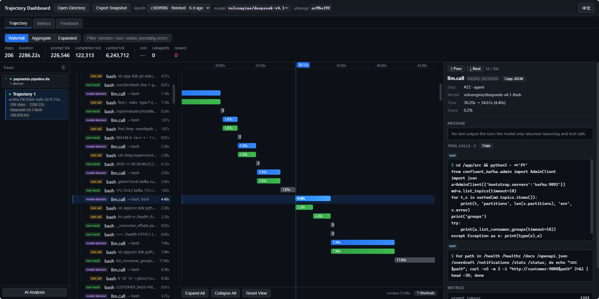

<h1 align="center">
  
</h1>

<p align="center">
  用 YAML 配置 Agent Harness 能力、推理引擎性能和算子性能评测，支持通过插件扩展评测组件。
</p>

<p align="center">
  
  
  
</p>

<p align="center">
  <a href="./README.md">English</a> | 中文
</p>

<p align="center">
  <a href="#快速开始">快速开始</a> ·
  <a href="#tracer">Tracer</a> ·
  <a href="docs/users/README.zh-CN.md">使用文档</a> ·
  <a href="playbook/README.md">实验配置</a>
</p>


## 能测什么

| 场景 | 测什么 | 上手指南 |
| --- | --- | --- |
| Agent Harness | 终端、代码和办公任务的得分与通过率 | [Terminal-Bench 快速入门](docs/users/quick-start/terminalbench.zh-CN.md) |
| 推理引擎 | 首 token 延迟（TTFT）、吞吐量，可选采集 vLLM KV Cache 利用率和 Ascend NPU AI Core 利用率 | [推理性能快速入门](docs/users/quick-start/agentx.zh-CN.md) |
| 算子 | Ascend NPU 上的正确性、执行耗时和加速比 | [算子评测指南](docs/users/benchmarks/kernel-npu.zh-CN.md) |

[完整 Benchmark 列表](docs/users/README.zh-CN.md#现在能测哪些-benchmark)

## 快速开始

[安装 CLI](docs/users/installation.zh-CN.md#直接安装)后，用 SimpleAgent 在本机评测两道 GSM8K 题。将示例里的模型名和地址换成自己的服务，服务需支持 OpenAI Chat Completions 和工具调用。在仓库根目录用 Bash 执行以下命令。

```bash
export MODEL_NAME="your-model-id"
export MODEL_ENDPOINT="https://your-model-service.example/v1"
read -rsp 'Model API key: ' MODEL_API_KEY
printf '\n'
export MODEL_API_KEY

ember-evaluator inspect playbook/gsm8k/gsm8k-quick-start.yaml
ember-evaluator run playbook/gsm8k/gsm8k-quick-start.yaml
```

`inspect` 显示展开后的配置。评测结束后，打开终端所示结果目录里的 `report.md`。 [完整步骤和 PowerShell 用法](docs/users/quick-start.zh-CN.md)

## Tracer

用同一份配置查看 Agent 执行轨迹、性能指标和优化反馈。Tracer 会按需启动本地 Collector。

```bash
ember-evaluator run playbook/gsm8k/gsm8k-quick-start.yaml --tracer
```

在运行 Collector 的机器上，将 `http://127.0.0.1:8787` 粘贴到浏览器地址栏。



[Tracer 配置与排查指南](docs/users/tracer.zh-CN.md)

## 插件扩展

用 YAML 选择组件，用 `--patch` 加载自定义组件。 [新增 Solver](docs/development/add-solver.md) · [新增内置基础组件](docs/development/add-built-in-plugin.md) · [新增外部插件](docs/development/add-external-plugin.md) · [源码架构](docs/development/architecture.md)

## 评测结果

模型为 **DeepSeek V4.1 Flash 1017**。分数按各题库自己的规则计算。

| Benchmark | Agent Harness | 结果 |
| --- | --- | --- |
| GSM8K | SimpleAgent | 92.34% (1,218 / 1,319) |
| MMLU | choice-logprobs | 88.83% (12,474 / 14,042) |
| WorkBuddy | SimpleAgent | Office 0.8502 · Code 0.9009 · Web 0.7957 |
| OfficeQA Pro V2 | SimpleAgent | 56.67% (51 / 90) |

## 文档

- [使用指南](docs/users/README.zh-CN.md) · [实验配置](playbook/README.md) · [Node.js SDK](docs/users/sdk.zh-CN.md)
- [CLI 命令](docs/users/reference/cli.zh-CN.md) · [实验 YAML 字段](docs/users/reference/experiment-yaml.zh-CN.md) · [Solver 与模型服务](docs/users/solvers.zh-CN.md)
- [安装与 Agent Skill](docs/users/installation.zh-CN.md) · [本地、Docker 与 Ray](docs/users/usage.zh-CN.md#本地docker-与-ray) · [镜像预热](docs/users/usage.zh-CN.md#只预热镜像不开始测评) · [ModelScope 镜像下载](docs/users/image-downloads.zh-CN.md#从-modelscope-下载任务镜像)
- [续跑与重建报告](docs/users/usage.zh-CN.md#续跑与重建报告) · [网络故障补测](docs/users/network-retry.zh-CN.md) · [常见问题](docs/users/faq/README.zh-CN.md)

## 🙏 致谢

感谢 Cordis 的维护者和贡献者。Ember Evaluator 使用 Cordis 注册插件并管理组件生命周期。[Cordis 项目](https://github.com/cordiverse/cordis)

感谢 Harbor 的维护者和贡献者。Ember Evaluator 支持 Harbor 任务包，并遵循 Harbor 协议执行和验证任务。[Harbor 项目](https://github.com/harbor-framework/harbor)

## 🔗 相关项目

- [Ember RSI](https://github.com/evolving-foundry/ember-rsi)：通过可衡量的实验开展迭代优化的工具。
- [AgentBundle](https://github.com/evolving-foundry/agentbundle)：跨运行时验证、安装和管理 Agent Bundle 的统一 CLI 与 SDK。

