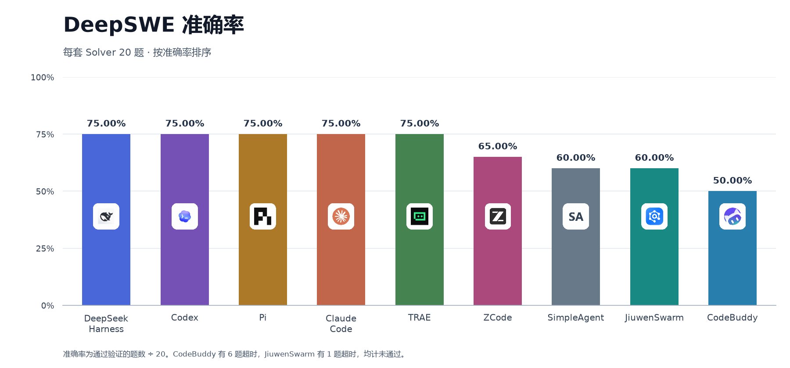
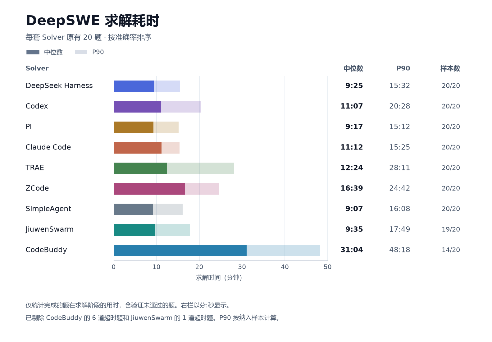
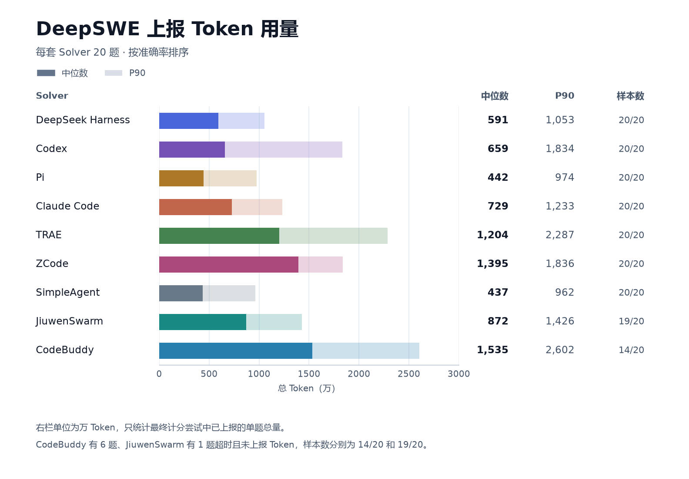

# DeepSWE 1.1 · deepseek-v4.1-flash-1017

九种 Solver 修复同一组 20 个代码任务。DeepSeek Harness、Codex、Pi、Claude Code 和 TRAE 各通过 15 题（75%）。在这组题上，多通过一道就相差 5 个百分点。[运行报告与题单](report.md) · [全部实验](../../README.md)

## 任务和评分

从固定版本的 113 个任务中选取 20 个，所选题号在按名称排序的清单中等间距分布。Solver 在任务工作区修改代码，Harbor 的验证程序运行任务自带的测试，主奖励 `reward` 达到 1 计为通过。`f2p`、`p2p` 和 `partial` 可在原始运行报告中查看。

180 个最终结果来自 14 次运行。CodeBuddy 有 6 题求解超时，JiuwenSwarm 有 1 题。超时计入通过率的分母。这 7 题均缺少 Token 上报，因此 CodeBuddy 的耗时和用量分位数基于 14 题，JiuwenSwarm 基于 19 题。

**模型标识有一处限制。** 本组沿用原图的 DeepSeek 批次名。Claude Code 的 20 个结果均记录客户端别名 `claude-sonnet-4-5-20250929`，这条线路的上游模型版本无法从归档确认。比较固定模型下的 Solver 表现时，应单独标注这一行。

## 准确率

## 求解耗时

## 上报 Token 用量

