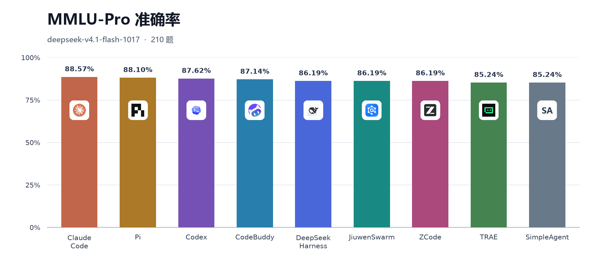
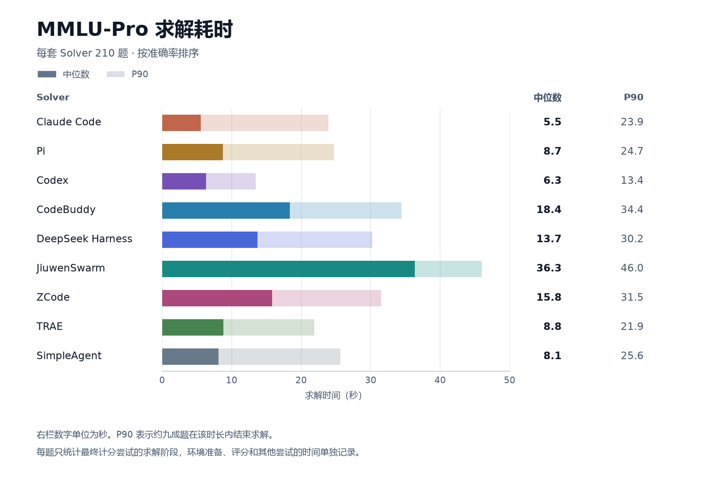
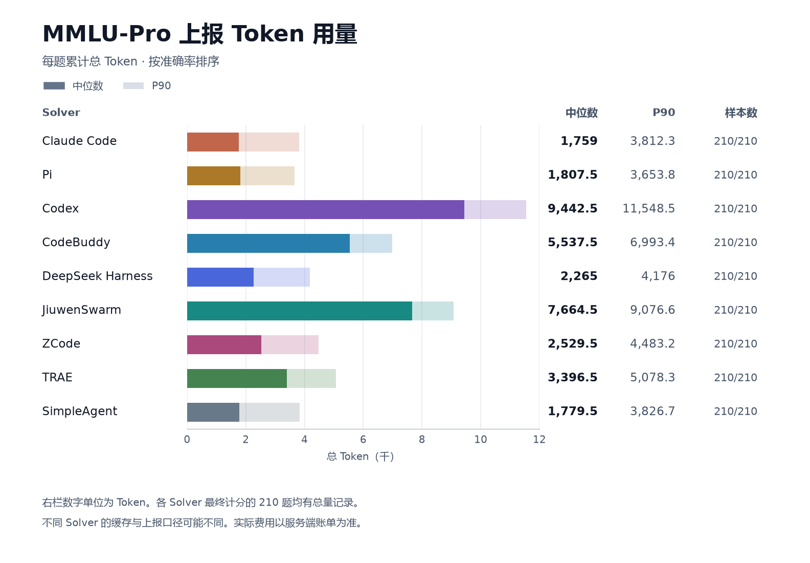

# MMLU-Pro · deepseek-v4.1-flash-1017

九种 Solver 使用同一模型配置和同一组选择题。实验要求独立作答，禁止调用工具或联网查资料。它比较的是在这些限制下，Solver 自带的系统提示词、消息格式和作答流程怎样影响模型的最终选择。Claude Code 答对 186/210（88.57%），Pi 答对 185/210（88.10%），两者相差 1 题。[运行报告、分领域成绩与题单](report.md) · [全部实验](../../README.md)

## 题单和评分

从 MMLU-Pro 测试集的 14 个领域各抽 15 题，种子为 42，排除已用于试跑的题号 `test:6191`。各 Solver 收到相同的题面、选项及同领域示例。评分器从最终回复提取选项，与标准答案匹配得 1 分。1,890 份最终答卷中有 17 份未提取到有效选项，均计 0 分。

## 工具、联网与结果解释

八种 Solver 配置 `tools=none`，同时关闭网页搜索和网页抓取。Codex 单独关闭 Shell、网页搜索和网页抓取。全部 1,890 条选中记录的工具调用数均为 0。这里的联网限制指禁止用外网检索答案，运行时仍需请求模型服务。归档提供了 Solver 配置与轨迹中的调用计数，未提供容器级出站流量审计。

八种 Solver 的首轮求解时限为 240 秒，其中 6 条超时记录以 600 秒补测。Codex 单独以 600 秒运行。不同 Solver 还使用不同的模型请求协议和回复格式，所以这组数据可以比较整套提示与作答流程的效果，无法单独估计某一句系统提示词带来的分数变化。

## 准确率

## 求解耗时

## 上报 Token 用量

