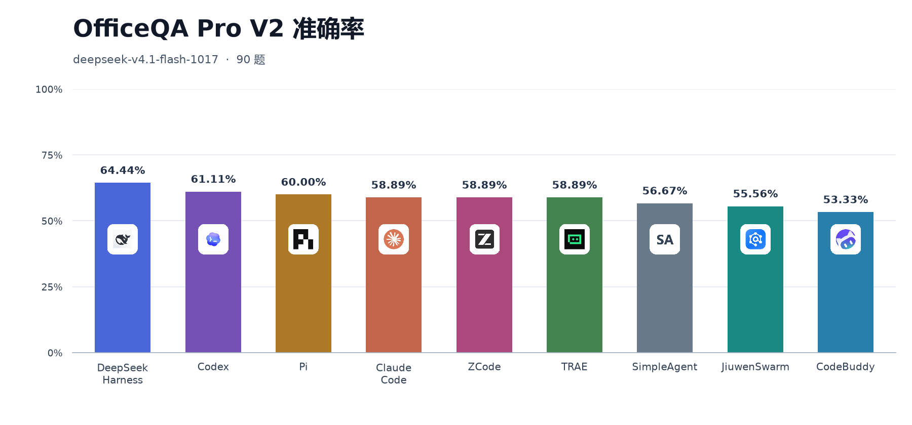
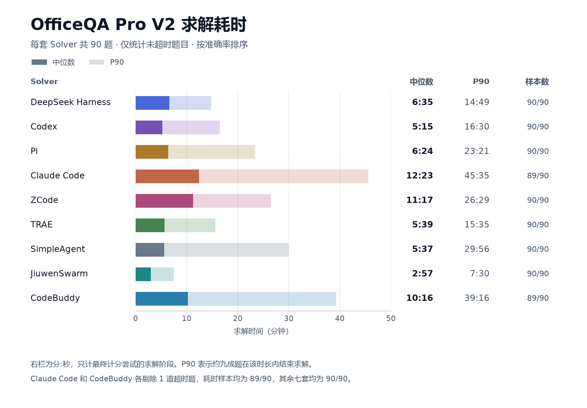
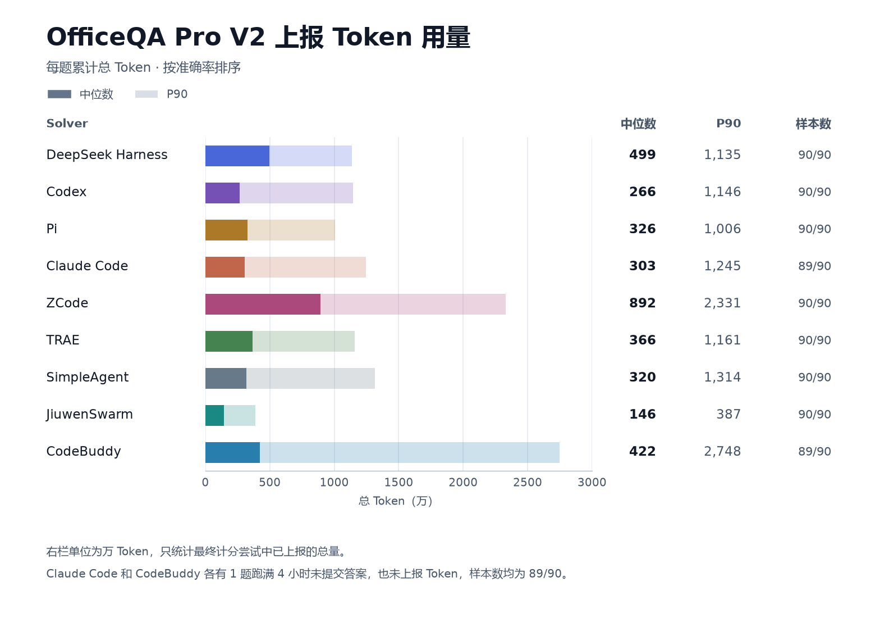

# OfficeQA Pro V2 · deepseek-v4.1-flash-1017

九种 Solver 各回答全部 90 道财政文档问答题。DeepSeek Harness 答对 58 题（64.44%），Codex 答对 55 题（61.11%）。JiuwenSwarm 的求解耗时中位数最短，为 2 分 57 秒，答对 50 题。[运行报告与题单](report.md) · [相同题库的 GLM 实验](../glm-5.3-flash/README.md) · [全部实验](../../README.md)

## 文档、评分与补测

Solver 可检索题目附带的 1,435 份财政文档解析文件（`parsed-json`），整理证据后提交最终答案。评分端使用题库固定版本的 `reward.py`，数值容忍度为 0。

最终成绩采用 37 次运行中的 810 条逐题记录。初始及协议续跑阶段答对 471 题次，含 20 次求解超时。对超时题补测后，两小时阶段答对 475 题次，仍有 9 次超时。四小时阶段剩余 2 次超时，810 个最终对错判定与两小时阶段相同。Claude Code 和 CodeBuddy 各有 1 次最终超时，耗时和 Token 各纳入 89 题，其余七种 Solver 均纳入 90 题。

## 准确率

## 求解耗时

## 上报 Token 用量

