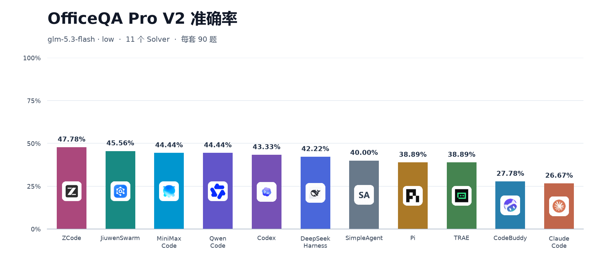
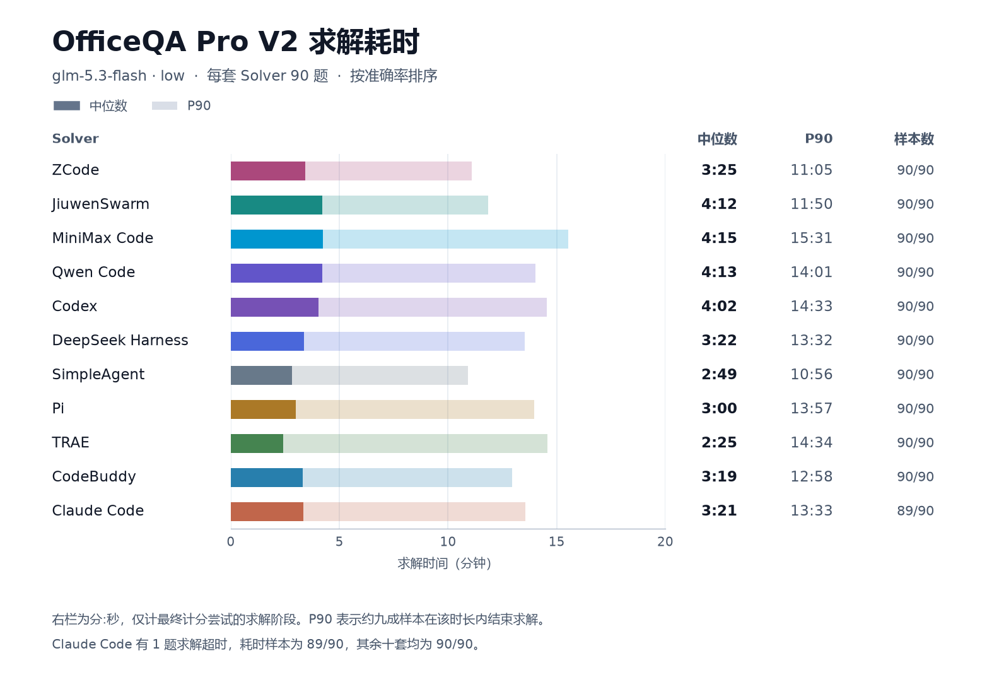
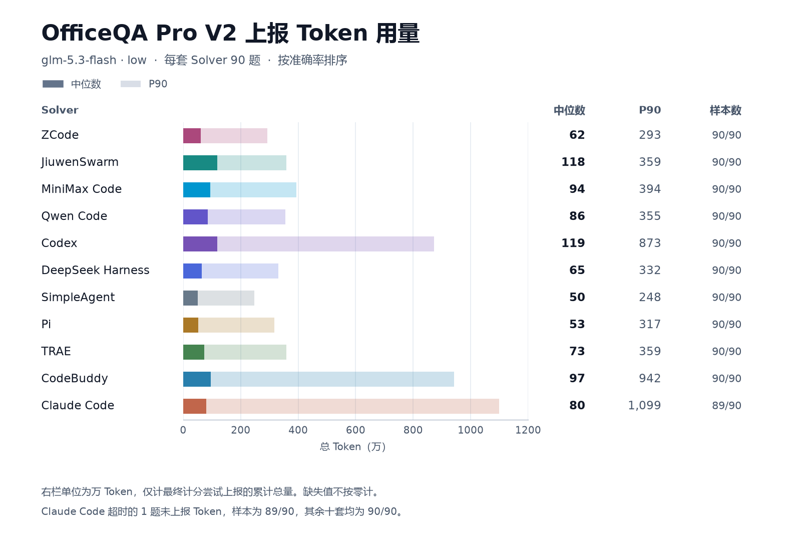

# OfficeQA Pro V2 · glm-5.3-flash

本批将 `reasoningEffort` 设为 `low`。十一种 Solver 各回答全部 90 道题，ZCode 答对 43 题（47.78%），JiuwenSwarm 答对 41 题（45.56%），MiniMax Code 和 Qwen Code 均答对 40 题（44.44%）。[运行报告](report.md) · [相同题库的 DeepSeek 实验](../deepseek-v4.1-flash-1017/README.md) · [全部实验](../../README.md)

## 文档、评分与补测

本组与 DeepSeek 组使用同一版本的 90 道题、`parsed-json` 财政文档语料和评分脚本，数值容忍度均为 0。两组在同一题库上观察到不同的 Solver 排序。ZCode 在本组答对 43 题，居首。在 DeepSeek 组答对 53 题，与 Claude Code、TRAE 和 Qwen Code 并列。两批运行的模型、推理配置及补测过程需随成绩一起比较。

原有九种 Solver 的最终清单使用 11 次运行中的 810 条记录。CodeBuddy 的题号 `84` 和 JiuwenSwarm 的题号 `61` 各采用一次有效补测。Claude Code 的题号 `46` 求解超时，计 0 分，耗时与 Token 各纳入 89 题。其余十种 Solver 的耗时和 Token 都有 90 题。

MiniMax Code 和 Qwen Code 各独立完成 90 题，均答对 40 题（44.44%）。两套补测沿用 `low` 推理强度，每题求解限时 2 小时，验证限时 1 小时。

全组汇总使用 13 次运行，共 990 条有效计分记录。[Evaluator 原始运行报告](run-reports.zip)

## 准确率

## 求解耗时

## 上报 Token 用量

