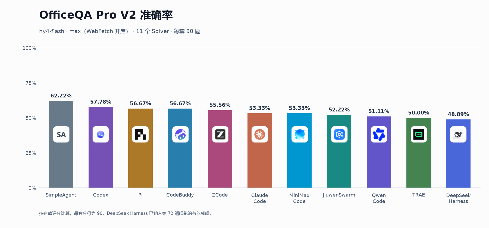
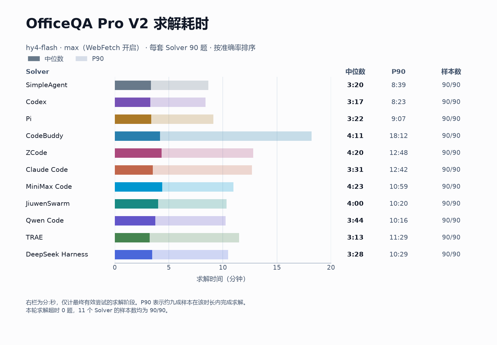
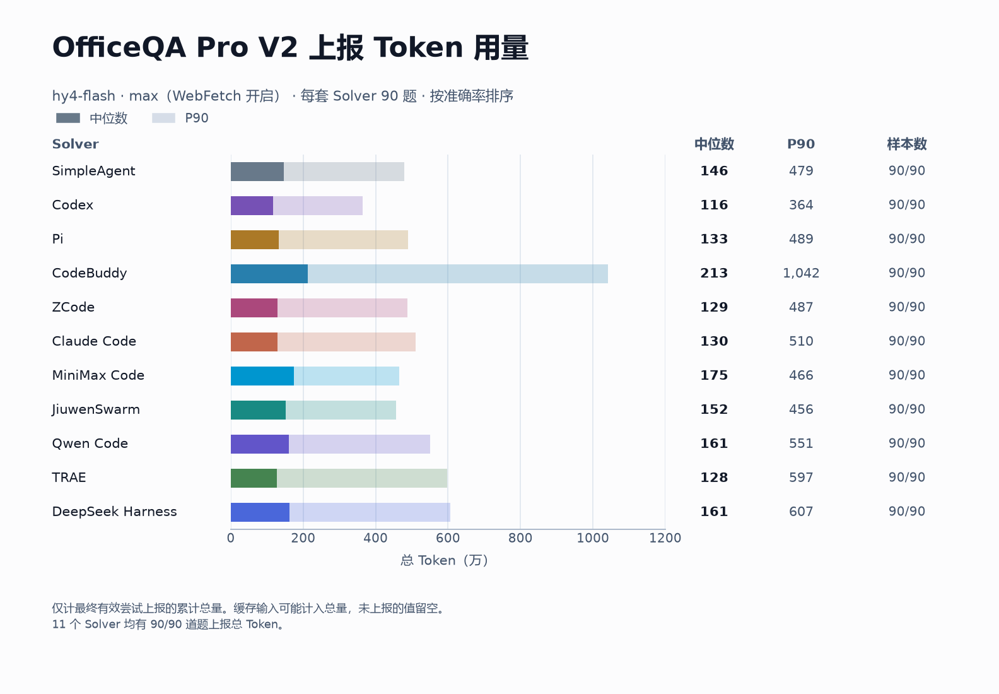

# OfficeQA Pro V2 · hy4-flash

本组使用 `max` 推理强度。十一种 Solver 各跑同一组 90 题，合计答对 538/990 题次（54.34%）。SimpleAgent 答对 56 题（62.22%），居本组首位。Codex 答对 52 题（57.78%），其求解耗时中位数为 3 分 17 秒，低于 SimpleAgent 的 3 分 20 秒。[运行报告](report.md) · [全部实验](../../README.md)

## 实验条件与补测

使用 Evaluator 提交 `191548f`。语料为 `parsed-json` 财政文档，使用固定版本题库的评分脚本，数值容忍度为 0。模型上下文配置为 1,000,000 Token，上游单次输出上限为 65,536 Token。每题求解限时 2 小时，验证限时 1 小时。

正式批次关闭 MCP 并开启 WebFetch。除 Codex 外，其余十种 Solver 均关闭 WebSearch。Codex 使用原生组合网页工具，配置中 WebSearch 和 WebFetch 均开启。Pi 和 SimpleAgent 使用 Evaluator 提供的 `web_fetch`，其余使用各自的原生网页工具。

最终汇总使用 11 次正式运行，预检成绩不计入。DeepSeek Harness 第 `72` 题因上游网络错误失效，采用同一次运行续跑后得到的有效 0 分。Qwen Code 第 `47` 题的产物收集不完整，原评分为有效 0 分。全组无求解或验证超时，每种 Solver 的耗时与 Token 均有 90 个样本。

## 准确率

## 求解耗时

## 上报 Token 用量

