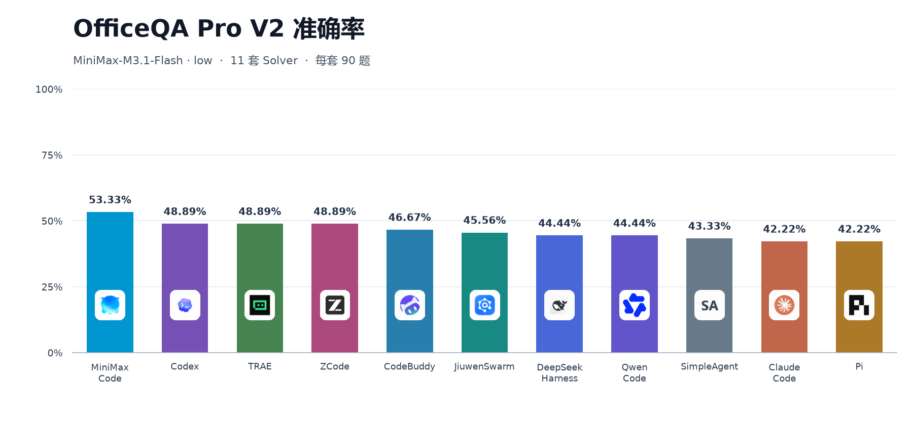
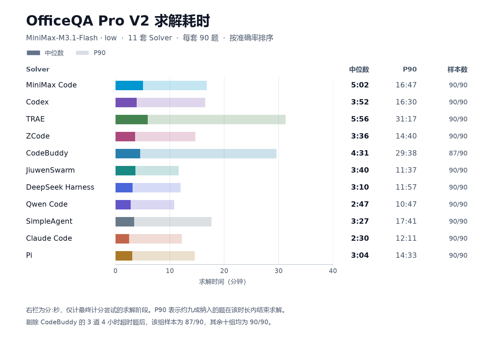
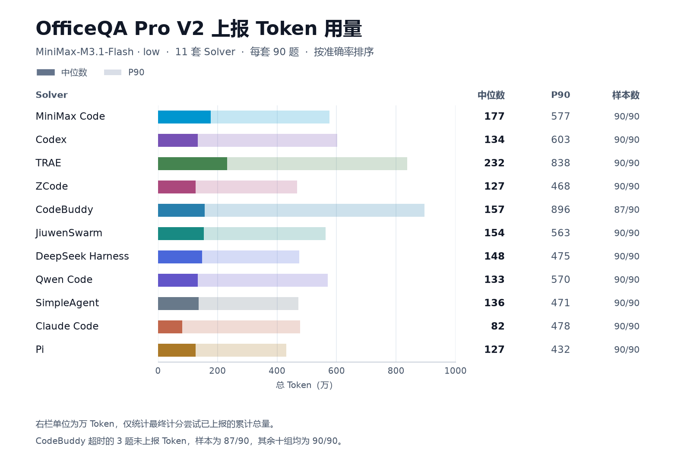

# OfficeQA Pro V2 · MiniMax-M3.1-Flash

推理强度为 `low`。十一种 Solver 各覆盖全部 90 题，合计答对 458/990 题次（46.26%）。MiniMax Code 答对 48 题（53.33%），居本组首位。Qwen Code 答对 40 题（44.44%），求解耗时中位数为 2 分 47 秒，P90 为 10 分 47 秒。[运行报告](report.md) · [全部实验](../../README.md)

## 实验条件与补测

使用固定版本的 OfficeQA Pro V2、`parsed-json` 财政文档语料和题库评分脚本，数值容忍度为 0。

原有九种 Solver 沿用 19 次运行的 810 条成绩。每题求解限时 4 小时，验证限时从原批次的 5 分钟延长到补测批次的 1 小时。Codex 第 `67` 题采用补跑结果。CodeBuddy 第 `38`、`46` 和 `81` 题求解超时，各计有效 0 分，耗时和 Token 各纳入其余 87 题。

Qwen Code 独立完成全量 90 题，使用 Evaluator 提交 `191548f`，并发 20，每题求解限时 4 小时、验证限时 1 小时。运行 ID 为 `5084dcae-45cb-4358-a044-848a0a9cab5f`。归档配置未显式记录 WebSearch 和 WebFetch 的开关。[Evaluator 原始运行报告](run-reports.zip)

MiniMax Code 的成绩可用[历史逐题快照](minimax-code-snapshot.json)复算。快照含 90 道题的得分、求解耗时、超时标记和总 Token。原始运行 ID 和报告未随快照提供。

## 准确率

## 求解耗时

## 上报 Token 用量

