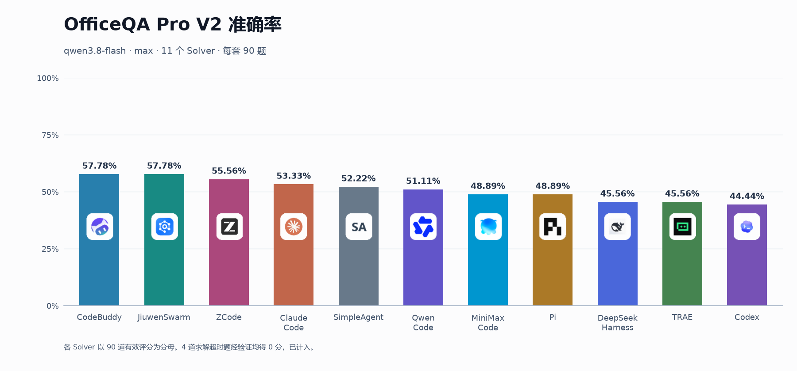
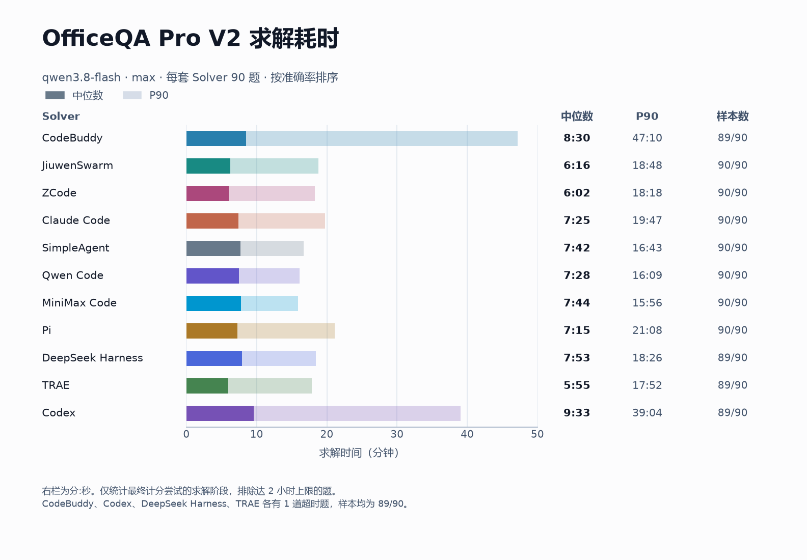
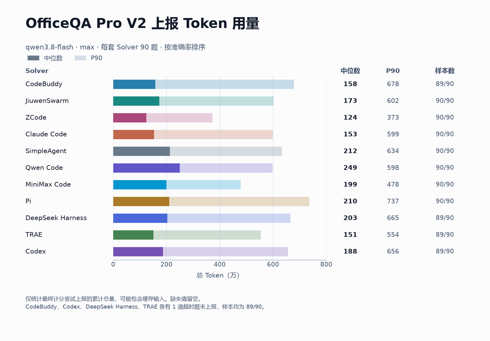

# OfficeQA Pro V2 · qwen3.8-flash

本组使用 `max` 推理强度。十一种 Solver 各跑同一组 90 题，合计答对 505/990 题次（51.01%）。CodeBuddy 与 JiuwenSwarm 均答对 52 题（57.78%），后者求解耗时中位数更短（6 分 16 秒对 8 分 30 秒）。[运行报告](report.md) · [全部实验](../../README.md)

## 实验条件与补测

语料为 `parsed-json` 财政文档，使用固定版本题库的评分脚本，数值容忍度为 0。模型上下文配置为 1,000,000 Token。每题求解限时 2 小时，验证限时 1 小时。

正式批次关闭 MCP 并开启 WebFetch。除 Codex 外，其余十种 Solver 均关闭 WebSearch。Codex 使用原生组合网页工具，配置中 WebSearch 和 WebFetch 均开启。Pi 和 SimpleAgent 使用 Evaluator 提供的 `web_fetch`，其余使用各自的原生网页工具。

最终汇总使用 11 次全量运行和 4 次单题补测。CodeBuddy 第 `29` 题补测得 1 分，MiniMax Code 第 `29`、Codex 第 `61`、JiuwenSwarm 第 `82` 题补测均为有效 0 分。CodeBuddy 第 `58`、Codex 第 `82`、DeepSeek Harness 第 `54` 和 TRAE 第 `46` 题达到 2 小时求解时限，经验证均为 0 分。这四种 Solver 的耗时与 Token 各纳入 89 题，其余各纳入 90 题。

## 准确率

## 求解耗时

## 上报 Token 用量

