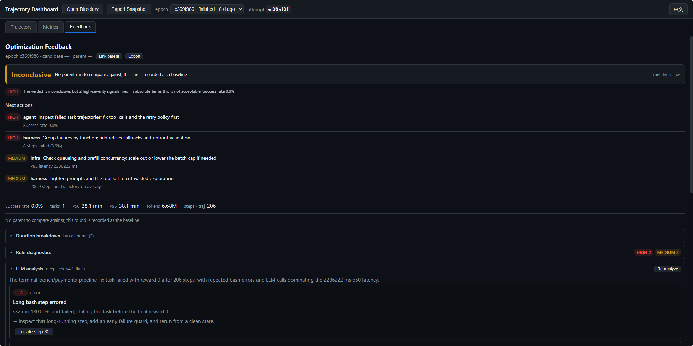

# Tracer

> English | [中文](./tracer.zh-CN.md)

[User guide](README.md) · [Tracer CLI reference](reference/cli.md#tracer)

## View an Evaluation

Tracer ships with Ember Evaluator. It mirrors attempt evidence to a Collector that runs as a Node.js process and stores the data in SQLite. The configured Store remains the source of record for evaluation results. Collector connection and delivery failures produce warnings while the evaluation continues.

From the repository root, set the model variables from the [GSM8K quick start](quick-start.md#3-set-model-variables), then run:

```bash
ember-evaluator run playbook/gsm8k/gsm8k-quick-start.yaml --tracer
```

By default, Tracer starts the local Collector on demand or reuses a healthy instance with the same database. On the machine running the Collector, enter `http://127.0.0.1:8787` in your browser's address bar. Use **Trajectory** to inspect model calls and tool events, **Metrics** to view profiling data, and **Feedback** to see rule-based feedback and any configured LLM analysis. Feedback can also be exported for Ember RSI.

Pass a URL after `--tracer` to override the Collector address for that run. To start the Collector independently, check its status, view logs, or stop it, see the [CLI reference](reference/cli.md#tracer).

### Analyze a Trajectory

**Feedback** shows rule-based diagnostics and suggested actions. When LLM analysis identifies a specific step, select **Locate step** to open it in the trajectory waterfall.



## Collector Configuration

Set these environment variables in the shell where you launch the evaluation or Collector. Default data paths are under the current working directory. If you change the database path, use the same path when you run the evaluation and manage the Collector.

| Variable | Default | What it controls |
| --- | --- | --- |
| `TRACER_URL` | `http://127.0.0.1:8787` | Collector address. A URL passed to `run --tracer` or `tracer serve --url` takes precedence. |
| `TRACER_DB` | `.cache/tracer/trace.db` | SQLite database. To keep an existing history, point this at its database file. |
| `TRACER_SPOOL` | `.cache/tracer/spool` | Directory for queued attempt data. |
| `TRACER_LOG` | `collector.log` next to the database | Overrides the log path for a Collector started with `ember-evaluator tracer serve`. Automatic startup through `run --tracer` writes beside the database. |
| `TRACER_COLLECTOR` | Bundled Collector entry point | Path to a different Collector entry point. |
| `TRACER_TOKEN` | Unset | Optional bearer token for the Collector's write APIs. |

The Collector inherits environment variables when it starts. After changing its settings, stop the existing process with its current database settings, then start it with the new settings. The CLI records the managed process in `tracer.pid` next to the database.

## Optional LLM Feedback

Rule-based feedback is available by default. For LLM analysis, the Collector needs an OpenAI-compatible Chat Completions endpoint and a model. Set these in the Collector's launch environment:

| Variable | Fallback or default |
| --- | --- |
| `TRACER_LLM_BASE_URL` | `MODEL_ENDPOINT` |
| `TRACER_LLM_MODEL` | `MODEL_NAME` |
| `TRACER_LLM_API_KEY` | `MODEL_API_KEY` |
| `TRACER_LLM_TIMEOUT` | 120 seconds |
| `TRACER_LLM_MAX_TOKENS` | 8000 |

For example, to use a separate model for feedback, set the variables and start a new Collector from Bash:

```bash
export TRACER_LLM_BASE_URL="https://your-model-service.example/v1"
export TRACER_LLM_MODEL="your-model-id"
read -rsp 'Tracer LLM API key: ' TRACER_LLM_API_KEY
printf '\n'
export TRACER_LLM_API_KEY
ember-evaluator tracer serve
```

If a Collector is already running, stop it before restarting with the new variables. If no endpoint or model is available after applying the fallbacks, the Feedback tab shows LLM analysis as unconfigured.

## Troubleshooting

- Run `ember-evaluator tracer status` to check the URL, database path, and health. If the database differs from the one used by the evaluation, set `TRACER_DB` to the same path or stop the old Collector before starting another on that address.
- Run `ember-evaluator tracer logs --lines 50` to inspect startup errors. If the Collector entry point is missing in a source installation, run `pnpm build` and retry.
