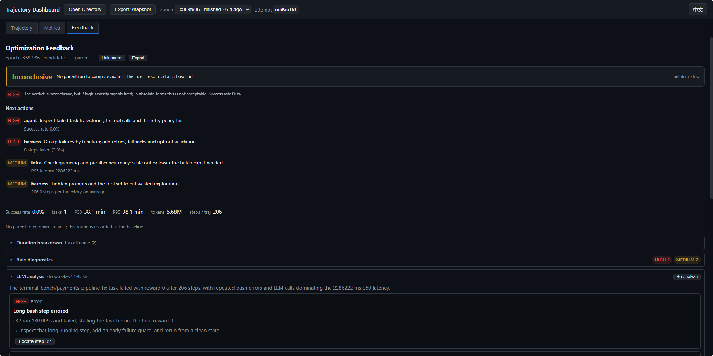

# Tracer

> [English](./tracer.md) | 中文

[使用指南](README.zh-CN.md) · [Tracer 命令参考](reference/cli.zh-CN.md#tracer)

## 查看评测过程

Tracer 随 Ember Evaluator 发布，将每次 Attempt 的评测证据同步到 Collector。Collector 作为 Node.js 进程运行，使用 SQLite 保存数据。评测结果以配置的 Store 为准。Collector 连接或推送失败时，评测会记录告警并继续运行。

在仓库根目录按 [GSM8K 快速开始](quick-start.zh-CN.md#3-设置模型变量)设置模型变量，然后执行：

```bash
ember-evaluator run playbook/gsm8k/gsm8k-quick-start.yaml --tracer
```

Tracer 默认按需启动本地 Collector，或复用使用同一数据库的健康实例。在运行 Collector 的机器上，将 `http://127.0.0.1:8787` 粘贴到浏览器地址栏。在 **Trajectory** 查看模型调用和工具事件，在 **Metrics** 查看性能指标，在 **Feedback** 查看规则反馈和已配置的 LLM 分析。反馈也可以导出给 Ember RSI。

在 `--tracer` 后传入 URL 可以为本次运行指定 Collector 地址。单独启动、查看状态、读取日志和停止 Collector 的命令见 [CLI 参考](reference/cli.zh-CN.md#tracer)。

### 分析轨迹

**Feedback** 展示规则诊断和改进建议。LLM 分析指出具体步骤时，点击 **Locate step** 可跳到轨迹瀑布图中的对应位置。



## Collector 配置

在启动评测或 Collector 的终端中设置这些环境变量。默认数据路径位于当前工作目录下。修改数据库路径后，评测和 Collector 管理命令需使用同一个路径。

| 环境变量 | 默认值 | 作用 |
| --- | --- | --- |
| `TRACER_URL` | `http://127.0.0.1:8787` | Collector 地址。`run --tracer` 或 `tracer serve --url` 显式传入的地址优先。 |
| `TRACER_DB` | `.cache/tracer/trace.db` | SQLite 数据库。需要保留历史记录时，将它指向已有数据库文件。 |
| `TRACER_SPOOL` | `.cache/tracer/spool` | 暂存待发送的 Attempt 数据。 |
| `TRACER_LOG` | 数据库同级的 `collector.log` | 指定通过 `ember-evaluator tracer serve` 启动的 Collector 日志路径。`run --tracer` 自动启动时，日志写在数据库同级目录。 |
| `TRACER_COLLECTOR` | 随包发布的 Collector 入口 | 指定其他 Collector 入口路径。 |
| `TRACER_TOKEN` | 未设置 | Collector 写入接口使用的可选 Bearer token。 |

Collector 在启动时继承环境变量。修改配置后，先使用当前数据库配置停止旧进程，再用新配置启动。CLI 将进程信息记录在数据库同级的 `tracer.pid` 中。

## 可选的 LLM 反馈

Collector 默认提供规则反馈。启用 LLM 分析需要一个兼容 OpenAI Chat Completions 的端点和模型。在启动 Collector 的终端中设置以下变量：

| 环境变量 | 回退值或默认值 |
| --- | --- |
| `TRACER_LLM_BASE_URL` | `MODEL_ENDPOINT` |
| `TRACER_LLM_MODEL` | `MODEL_NAME` |
| `TRACER_LLM_API_KEY` | `MODEL_API_KEY` |
| `TRACER_LLM_TIMEOUT` | 120 秒 |
| `TRACER_LLM_MAX_TOKENS` | 8000 |

如果要用单独的模型生成反馈，可在 Bash 中设置变量并启动 Collector：

```bash
export TRACER_LLM_BASE_URL="https://your-model-service.example/v1"
export TRACER_LLM_MODEL="your-model-id"
read -rsp 'Tracer LLM API key: ' TRACER_LLM_API_KEY
printf '\n'
export TRACER_LLM_API_KEY
ember-evaluator tracer serve
```

如果 Collector 已在运行，先停止再用新变量启动。应用回退值后仍缺少端点或模型时，Feedback 页会显示 LLM 分析未配置。

## 排查问题

- 用 `ember-evaluator tracer status` 检查地址、数据库路径和健康状态。如果 Collector 使用的数据库与评测配置不一致，可将 `TRACER_DB` 设为同一路径，或先停止旧 Collector 再在该地址启动新实例。
- 用 `ember-evaluator tracer logs --lines 50` 查看启动错误。如果源码安装找不到 Collector 入口，执行 `pnpm build` 后重试。
